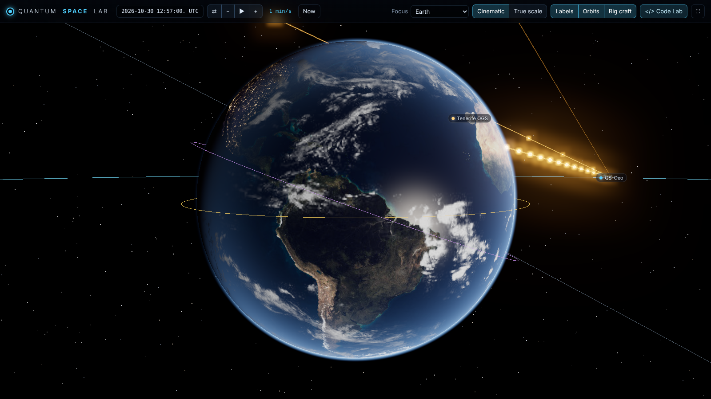
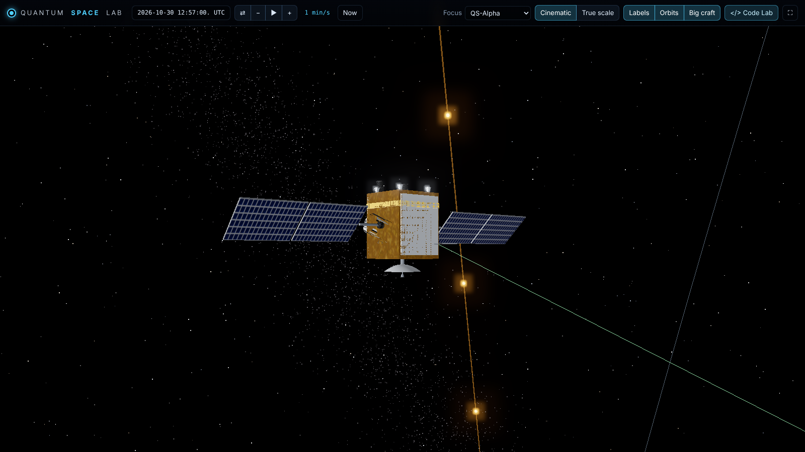

# Quantum Space Lab

A 3D simulator for **quantum entanglement links between satellites, the Moon, Mars and ground stations**.

- Real planetary positions (VSOP87 / ELP via astronomy-engine) at true astronomical distances
- Detailed 3D spacecraft and observatory models
- A physical photon-link model for every link
- A Qiskit lab for Bell tests, the E91 key exchange and your own quantum code

## ▶ Try it now (no install, works on phones)

**Live app: https://Dharsh08-S.github.io/entangled-satellites-project/**

The web version runs entirely in the browser: 3D view, link physics, Bell test and E91 key exchange.
The **Code Lab** (your own Qiskit code) needs the desktop version below.




## Features

**3D space**
- Earth with day and night sides (city lights), ocean glint, clouds and atmosphere.
- The Moon and Mars, both with correct rotation.
- The Sun, and a star field with the Milky Way.
- Two view modes:
  - **True scale**: real sizes and distances.
  - **Cinematic**: distances are compressed so Earth, Moon and Mars fit in one view. Telemetry always uses true distances.
- Fly to any body, satellite or ground station (double-click). The chase camera keeps the planet below the spacecraft.
- Time control from real time up to 1 week per second, forwards or backwards, at any date.

**Spacecraft and ground stations**
- Add satellites in any circular orbit around Earth, the Moon or Mars, including stationary (GEO / areostationary) orbits.
- Add optical ground stations. Presets include real observatories: Hanle, Mount Abu, Devasthal, Tenerife and others.
- Satellite models carry gold MLI foil, sun-tracking solar wings, a gimballed optical telescope that points at its link partner, a beacon laser, a nadir dish, star trackers and thrusters.

**Quantum link physics**, computed every frame for each link:
- Line of sight, with occultation by Earth (and its atmosphere), the Moon, Mars and the Sun.
- Ground-station elevation limit.
- Diffraction beam spreading, pointing-jitter loss, and atmospheric absorption and turbulence for up- and downlinks.
- Background light: deep space, sunlit-planet glare behind the source, day or night sky for ground stations, and Sun-in-view blinding.
- Detector efficiency, dark counts and accidental coincidences.
- Outputs: entangled pairs/s, good-pair fraction *p*, **CHSH S**, fidelity, QBER, sifted and secure key rates (BBM92), light travel time, Doppler shift and clock drift.

**Qiskit lab**:
- **Bell test**: CHSH measured on Qiskit Aer through the live channel noise.
- **E91 key exchange**: random bases, CHSH security check, sifting, QBER estimate, error-correction leakage and Toeplitz privacy amplification. An optional eavesdropper intercepts 25–100 % of the photons.
- **Code Lab**: write your own Qiskit code. The `link` variable holds the selected link's live telemetry.

## Desktop version with Qiskit (Linux Mint / Ubuntu)

```bash
cd entangled-satellites-project
python3 -m venv venv
source venv/bin/activate
pip install -r requirements.txt
python app.py
```

`python app.py` opens a desktop window. If the window stays blank on your graphics driver, run:

```bash
python app.py --browser
```

This opens the same app in Firefox or Chrome. Everything runs locally: the built-in server only listens on `127.0.0.1`.

## Controls

| Action | How |
|---|---|
| Rotate / zoom / pan | Left drag / scroll / right drag |
| Fly to an object | Double-click it, its label, or use **Focus** |
| Pause / speed | Space, `+` / `-` |
| Select a link | Click it in **Fleet → Quantum links**, or click a satellite |
| Run code | **Code Lab** → Ctrl+Enter |

## Physics model (summary)

The received two-photon state is modelled as a Werner state:

```
rho = p |Phi+><Phi+| + (1-p) I/4
p   = visibility * C / (C + A)
C   = R * eta_A * eta_link                     (true coincidences/s)
A   = (R*eta_A + d) * (R*eta_link + d + B) * tau  (accidental coincidences/s)
S   = 2*sqrt(2) * p
QBER = (1-p)/2
```

| Symbol | Meaning |
|---|---|
| R | pair rate |
| eta | transmission |
| d | dark counts |
| B | background |
| tau | coincidence window |

The link transmission is built from these terms:

```
eta_link = eta_geo * eta_point * eta_atm * eta_det
eta_geo  = 1 - exp(-2 a^2 / w(L)^2)
w(L)     = w0 * sqrt(1 + (L*lambda / (pi*w0^2))^2)        (Gaussian beam)
eta_point = w^2 / (w^2 + 4 (sigma*L)^2)                   (pointing jitter)
```

Simplifications in this version:
- circular orbits
- simple atmosphere and turbulence factors
- planet shadows for lighting only
- Doppler shift reported but assumed compensated

## Project layout

All files sit in one folder (no subfolders), so the repository can be uploaded through the GitHub website.

```
index.html, style.css         the app page
main.js, scene.js, models.js  3D engine, planets, spacecraft
physics.js                    ephemeris, orbits, link model
ui.js                         panels, telemetry, experiments
*.jpg / *.png                 planet textures and screenshots
three.module.js + passes      three.js library (MIT)
astronomy.browser.min.js      astronomy-engine (MIT)
app.py, quantum_backend.py,   desktop version with Qiskit
code_runner.py
```

## Credits

- [three.js](https://threejs.org) (MIT)
- [astronomy-engine](https://github.com/cosinekitty/astronomy) (MIT)
- Earth and Moon textures from the three.js examples
- Mars and Sun textures from threex.planets (planetpixelemporium maps)

## License

MIT
